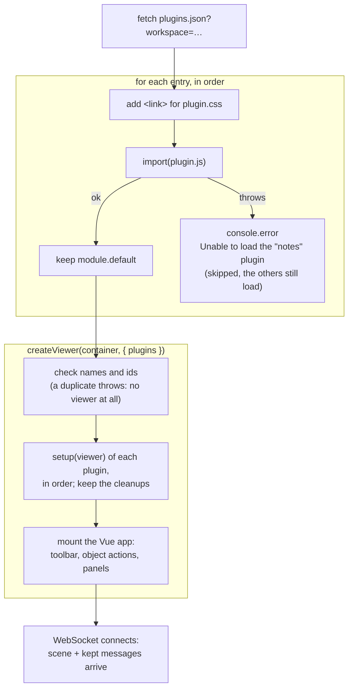
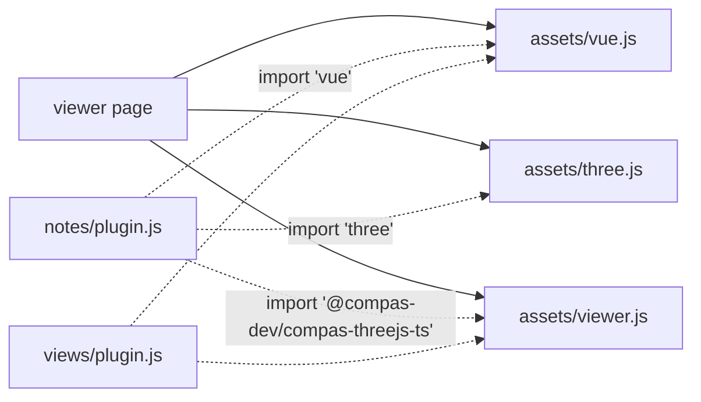
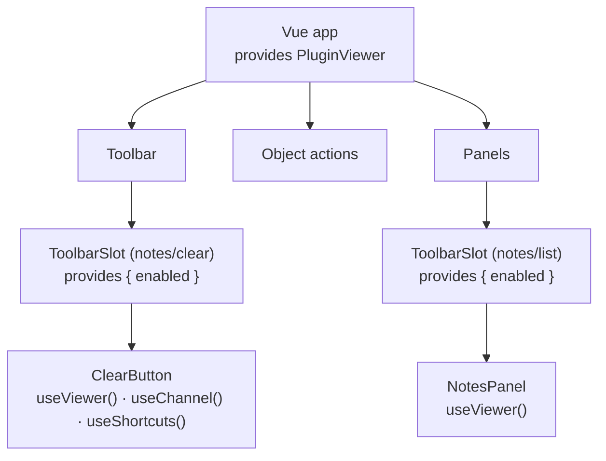
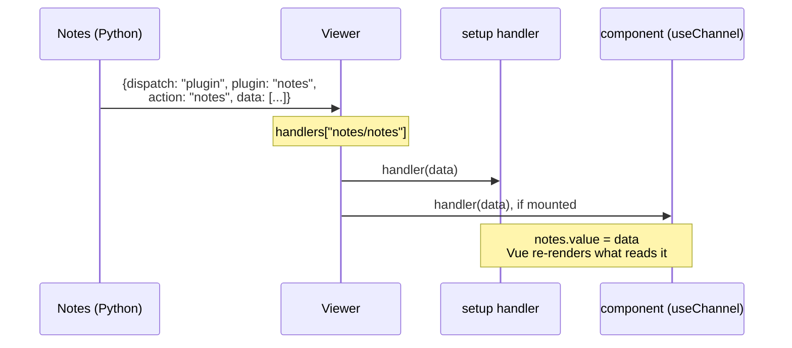
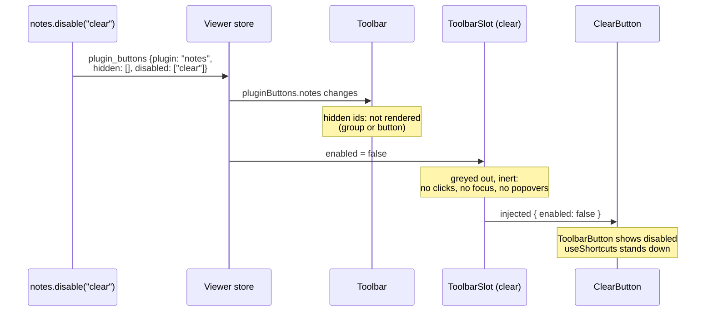
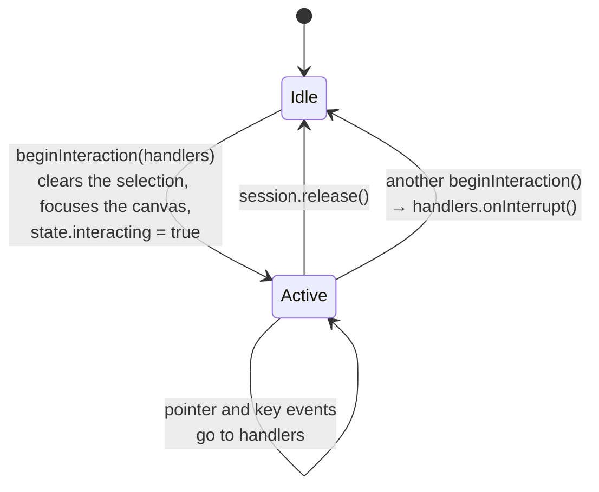
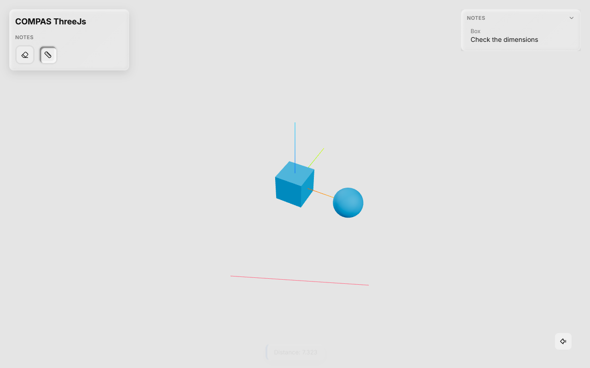

# The Frontend Half, Explained

This page goes through the TypeScript half of a plugin step by step: what
`definePlugin` returns, how the page loads it, when each component is mounted, how
messages reach `channel.on`, and how Python's hide and disable reach a button. It ends
with an interactive tool built on `beginInteraction`.

It is the counterpart of [The Python Half, Explained](python.md). The examples use the
`Notes` plugin from the [tutorial](tutorial.md).

## `definePlugin`: a plain object

```ts
export default definePlugin({
  name: "notes",
  groups: { edit: { clear: ClearButton } },
  setup(viewer) { /* ... */ },
});
```

`definePlugin` does nothing at run time. This is all of it:

```ts
export function definePlugin(plugin: ViewerPlugin): ViewerPlugin {
  return plugin;
}
```

It exists for TypeScript: wrapping the object checks every field against the
`ViewerPlugin` type and completes the field names in your editor. What the viewer needs
is the **module's default export**: an object with a `name`, and optionally `title`,
`groups`, `objectActions`, `panels`, `api` and `setup`.

So a plugin module is just an ES module:

```text
plugin.js
├── imports "vue", "three", "@compas-dev/compas-threejs-ts"   (left external, see below)
├── your components, compiled
└── export default { name: "notes", groups: {...}, setup() {...} }
```

## From module to screen

When a tab opens, the page loads each plugin listed in `plugins.json`, then creates the
viewer with all of them:



Points to take from it:

- **A plugin that fails to import is skipped**, with an error in the browser console.
  The viewer still opens with the other plugins.
- **A duplicate is fatal**: two plugins with the same `name`, or one plugin using an id
  twice across `groups`, buttons, `objectActions` and `panels`, throw before anything is
  mounted.
- **`setup` runs before any component exists**, once per page, in `app.plugins` order.
  What it returns is called when the viewer is disposed, in reverse order.
- **Messages come after `setup`.** A handler registered in `setup` is in place before
  the first message from Python arrives, including the kept (`key=`) ones.

## Shared libraries: the import map

The viewer page declares an import map:

```json
{
  "imports": {
    "vue": "./assets/vue.js",
    "three": "./assets/three.js",
    "@compas-dev/compas-threejs-ts": "./assets/viewer.js"
  }
}
```

A plugin built with these three left `external` keeps `import ... from "vue"` in its
`plugin.js`, and the browser resolves it to **the page's copy**:



One copy matters because Vue keeps its state per copy. `useViewer()` asks Vue for the
viewer the page provided; a plugin with its own Vue asks a different Vue, finds
nothing, and throws *"useViewer() must be called inside a viewer component"*. The same
goes for `three`: an object made with another copy of Three.js isn't a scene object to
the page's renderer.

Any other library (icons, a date library, ...) is bundled into `plugin.js` as usual.

## Components and `useViewer`

Components reach the viewer through Vue's `provide`/`inject`. The page provides the
`PluginViewer` once for the whole app, and each button slot adds its own state:



`useViewer`, `useChannel` and `useShortcuts` use `inject`, and Vue only allows that
**while a component is being set up**: at the top level of `<script setup>`, before any
`await`.

```vue
<script setup lang="ts">
const viewer = useViewer();            // ✓ top level
const channel = useChannel("notes");   // ✓

function onClick() {
  const viewer = useViewer();          // ✗ throws: not during setup
}
</script>
```

Call them once at the top and use the results anywhere. In a plugin's `setup(viewer)`
there is no component: the viewer is the argument, and `viewer.channel(name)` replaces
`useChannel`.

## When each part is mounted

A component's state lives as long as it is mounted, and so do the handlers it
registers. The parts of a plugin are mounted at different times:

| Part | Mounted | Unmounted |
| --- | --- | --- |
| `setup` | runs once, before the viewer mounts | its cleanup runs when the viewer is disposed |
| `groups` buttons | at start | while Python hides the button or its group |
| `objectActions` | while an object is picked | when nothing is picked, or while hidden |
| `panels` | at start | while hidden - *folding* a panel keeps it mounted |

A disabled part stays mounted, greyed out and inert.

This decides **where to keep state and where to listen**:

- **State shared by components, or that must survive a remount** goes in a module,
  outside any component - like `notes.ts`:

    ```ts
    export const notes = ref<Note[]>([]);   // one per page, for every component
    ```

- **Listening for state Python keeps** (`send(..., key=...)`) goes in `setup`. An object
  action listening for it itself would be mounted only after the user picks
  something - long after the kept message arrived, and it isn't sent again.
- **Listening for events meant for one component** can stay in the component with
  `useChannel`, which unsubscribes when the component unmounts.

## Messages

### Sending

```ts
const channel = useChannel("notes");
const sent = channel.send("write", { guid, text });
```

`send` serialises `data` as JSON and returns `true` if the message left. While the
WebSocket isn't open, it returns `false` and **the message is dropped**, not queued.
Sending is fire-and-forget: there is no reply to `await`. Python answers, if it does, as
a separate message.

### Receiving

```ts
const unsubscribe = viewer.channel("notes").on("notes", (data) => {
  notes.value = data as Note[];
});
```

Handlers are kept per `plugin/action`. When a message from Python arrives, the viewer
calls **every** handler of that pair, in the order they were added, with the decoded
`data`. A message that arrives with no handler for it is **lost**: there is no buffer.



| | `viewer.channel(name).on` | `useChannel(name).on` |
| --- | --- | --- |
| Use in | `setup`, or any code | components only |
| Unsubscribe | call the returned function (return it from `setup`) | automatic, when the component unmounts |

`data` is typed `unknown`: it is whatever Python sent, so cast it to the shape your
Python half sends (`data as Note[]`), or check it.

## Hide and disable: from Python to a button

`notes.disable("clear")` in Python reaches the button like this:



The plugin's components don't need to do anything: wrapping each button, action and
panel, the viewer's slot handles it. Two helpers also follow it:

- `ToolbarButton` renders as disabled.
- `useShortcuts` in that component ignores its keys.

The message is kept by the server, so a tab opened later starts with the same state.

## Keyboard shortcuts

```ts
useShortcuts({ n: clear, "?": help });
```

- Keys are compared with `event.key.toLowerCase()`: `"n"`, `"escape"`, `"?"`,
  `"arrowup"`.
- The listener is on the viewer's root element: keys count while the focus is inside
  the viewer, not in another part of a page that embeds it.
- A key is ignored with Ctrl, Cmd or Alt held, while typing in an input, a textarea, a
  select or editable content, while the component's button is disabled, and while a
  plugin holds input with `beginInteraction`.
- A handled key gets `preventDefault()`.
- Shortcuts are bound while the component is mounted. A hidden button has none.
- Nothing arbitrates between plugins: if two bind the same key, both run. Pick keys the
  other plugins in your app don't use.

`ToolbarButton`'s `shortcut` prop only *displays* the key in the tooltip; the binding is
`useShortcuts`.

## Interactive tools: `beginInteraction`

A tool that turns clicks in the view into points (drawing, measuring, placing) needs
the clicks *instead of* the viewer: no picking, no other shortcuts. That is
`viewer.three.beginInteraction(handlers)`, which returns a session:



While a session is active:

- `onPointerDown`, `onPointerMove` and `onKeyDown` get the events.
- Picking is off, and every `useShortcuts` stands down.
- **Orbiting keeps working**, so the user can turn the view mid-tool.

Only one session exists at a time. Starting a second one ends the first and calls its
`onInterrupt`, so a tool always learns that it has ended.

Here is a complete tool, a ruler that measures between two clicks on the ground plane:



```vue title="frontend/MeasureButton.vue"
<template>
  <ToolbarButton
    tooltip="Measure a distance"
    shortcut="M"
    :active="measuring"
    @click="toggle"
  >
    <Ruler />
  </ToolbarButton>
</template>

<script setup lang="ts">
import {
  ToolbarButton,
  useShortcuts,
  useViewer,
  type InteractionSession,
} from "@compas-dev/compas-threejs-ts";
import { Ruler } from "lucide-vue-next";
import * as THREE from "three";
import { onBeforeUnmount, ref } from "vue";

const viewer = useViewer();
const ground = new THREE.Plane(new THREE.Vector3(0, 0, 1), 0); // z = 0
const measuring = ref(false);

let session: InteractionSession | null = null;
let points: THREE.Vector3[] = [];
let removeLine: (() => void) | null = null;

function start() {
  points = [];
  session = viewer.three.beginInteraction({
    onPointerDown(event) {
      const ray = viewer.three.pointerRay(event);
      const point = ray?.intersectPlane(ground, new THREE.Vector3());
      if (!point) return;
      points.push(point);
      if (points.length === 2) {
        showLine(points[0]!, points[1]!);
        viewer.notify(`Distance: ${points[0]!.distanceTo(points[1]!).toFixed(3)}`);
        stop();
      }
    },
    onKeyDown(event) {
      if (event.key === "Escape") stop();
    },
    // Another tool began its own session: this one is over.
    onInterrupt: () => finish(),
  });
  measuring.value = true;
}

function showLine(a: THREE.Vector3, b: THREE.Vector3) {
  removeLine?.();
  const geometry = new THREE.BufferGeometry().setFromPoints([a, b]);
  const line = new THREE.Line(geometry, new THREE.LineBasicMaterial({ color: "#e11d48" }));
  const remove = viewer.three.addOverlay(line);
  removeLine = () => {
    remove();
    geometry.dispose();
  };
}

function stop() {
  session?.release();
  finish();
}

function finish() {
  session = null;
  measuring.value = false;
}

const toggle = () => (measuring.value ? stop() : start());
useShortcuts({ m: toggle });

onBeforeUnmount(() => {
  stop();
  removeLine?.();
});
</script>
```

What each `viewer.three` call does here:

`pointerRay(event)`
:   The world-space ray under the pointer, or `null` while the canvas has no size. The
    world is **Z-up** and in the same units as COMPAS, so points can go to Python
    as they are.

`addOverlay(object)`
:   Adds a Three.js object of the plugin's to the scene. Overlays are never picked, and
    the returned function removes them. Disposing their geometry and material is up to
    you.

`beginInteraction` / `release`
:   As above. `release()` can be called more than once safely. The `onBeforeUnmount`
    releases the session if Python hides the button mid-measure.

Register it like any button: `groups: { tools: { measure: MeasureButton } }`. The
plugin needs `three` and `@types/three` as dev dependencies to compile. At run time,
`three` is the page's copy.

Other `viewer.three` calls for tools of this kind:

| Call | For |
| --- | --- |
| `object(guid)` | the Three.js object of a backend geometry |
| `objects()` | every visible backend object, with its guid (snapping) |
| `pauseNavigation()` | stop orbiting during a drag; call the result to resume |
| `addPickGuard(guard)` | veto picks while `guard(event)` returns true |
| `holdObjectUpdates(guid)` | ignore Python's updates of an object while the user drags it |
| `viewportSize()`, `onResize(listener)` | screen-space overlays |
| `camera`, `canvas` | the Three.js camera and the canvas element |

`viewer.objects.commitTransform(guid, matrix)` tells Python that an object moved, which
is how a gizmo ends a drag.

## Plugins that use each other

A plugin can offer functions to others through `api`:

```ts
// in the Notes plugin
export interface NotesApi {
  count(): number;
}

export default definePlugin({
  name: "notes",
  api: { count: () => notes.value.length } satisfies NotesApi,
  /* ... */
});
```

```ts
// in another plugin, at the moment it's needed
const notesApi = viewer.plugin<NotesApi>("notes");
if (notesApi) console.log(notesApi.count());
```

`viewer.plugin(name)` returns `undefined` when this page doesn't load that plugin; the
app or workspace may not include it. Ask for it when you use it, not in `setup`,
since a plugin listed later isn't set up yet.

For simple shared settings, `viewer.state.snap` (`{ grid, angle }`) is read and written
by any plugin. A drawing plugin sets the snap steps, and the gizmo follows them.

## Without Python

The same plugin object works with the viewer used as a TypeScript library, without the
Python server:

```ts
import { createViewer } from "@compas-dev/compas-threejs-ts";
import notes from "./notes-plugin";

createViewer(document.querySelector("#app")!, { plugins: [notes] });
```

`channel.send` then returns `false` (unless the viewer was given a `send` option) and
nothing arrives on `channel.on`. A plugin meant for both uses should work without its
Python half, or say that it needs it.

## Checklist

- [x] `plugin.js` default-exports `definePlugin({ name, ... })`, with the Python `name`.
- [x] `vue`, `three` and `@compas-dev/compas-threejs-ts` are `external` in the build.
- [x] `useViewer`, `useChannel`, `useShortcuts` are called at the top of `<script setup>`.
- [x] Ids are unique across groups, buttons, object actions and panels.
- [x] State Python keeps (`key=`) is received in `setup`, into module-level state.
- [x] `setup` returns a cleanup for what it registered.
- [x] Interactive tools handle `onInterrupt` and release their session on unmount.
- [x] Overlays are removed and their geometry disposed.
