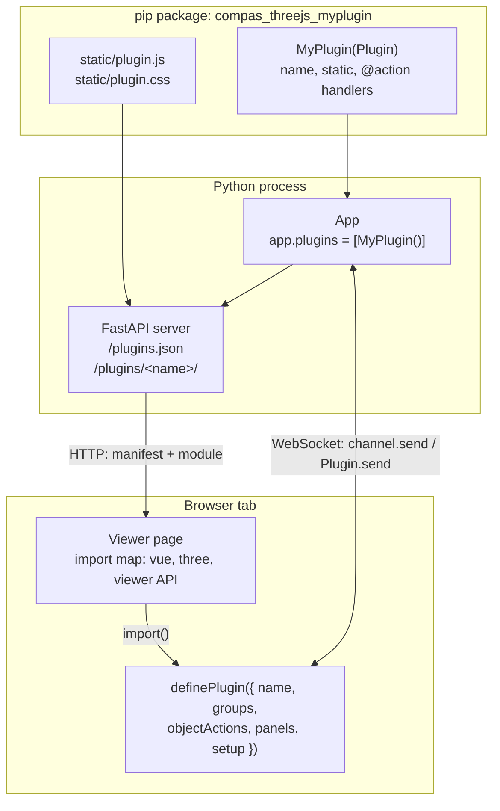
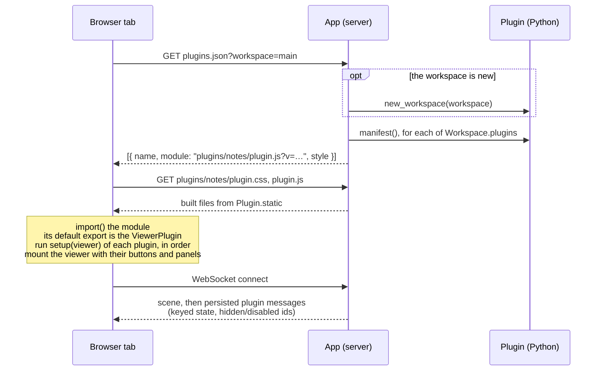
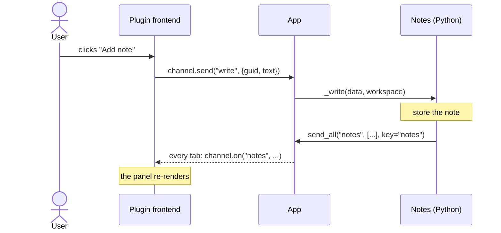
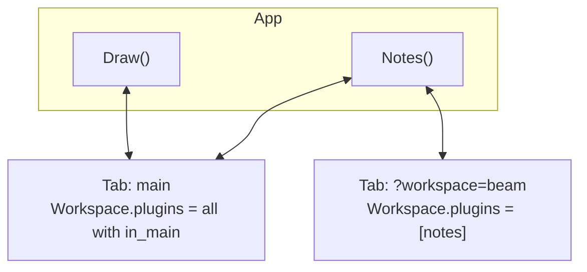

# How Plugins Work

The viewer itself is a renderer: it shows geometry, lets the user orbit and pick, and
talks to Python. Everything else - the toolbar, the gizmo, view presets, drawing tools,
panels - comes from **plugins**. With no plugins, the viewer starts without a toolbar.

```python
from compas_threejs.viewer import App
from compas_threejs_essentials import Essentials
from compas_threejs_views import Views

app = App()
app.plugins = [Essentials(), Views()]  # toolbar order; set before start()
app.start()
```

A plugin is a pip package. It carries two halves that belong together:

- a **frontend**, Vue components and TypeScript, built once into `static/plugin.js`
  (and `plugin.css`) and shipped inside the wheel - users never need Node.js;
- a **Python half**, a subclass of [`Plugin`](../reference/viewer/plugin.md), that
  serves the frontend and answers its messages.

## The two halves



The two halves share one thing: the plugin's **name**. Python's `Plugin.name` and the
frontend's `definePlugin({ name })` must be the same string - it routes every message
between them.

| | Frontend (TypeScript) | Python |
| --- | --- | --- |
| Declare | `definePlugin({ name, ... })`, default export of `plugin.js` | `class MyPlugin(Plugin)` with `name` and `static` |
| Send | `channel.send(action, data)` | `self.send(action, data)` / `self.send_all(...)` |
| Receive | `channel.on(action, handler)` | `@action("name")` methods, or `plugin.on("name")` from outside |
| Viewer access | `useViewer()` / `setup(viewer)` | `self.app` |
| Control the UI | - | `hide`, `show`, `disable`, `enable` by id; `notify` |

## How a page loads its plugins

When a browser tab opens the viewer, it asks Python which plugins to load before it
creates the viewer:



Some consequences:

- **Shared libraries.** The page maps `vue`, `three` and `@compas-dev/compas-threejs-ts`
  with an import map, so a plugin is built with those three left *external* and uses
  the page's copies. That is what makes `useViewer()` and the UI components work inside
  a plugin.
- **Cache busting.** Each file's URL carries its modification time (`?v=...`), so a
  rebuilt plugin is picked up on reload.
- **Order.** `app.plugins` is the order of the toolbar sections and the order in which
  `setup` runs.
- **Late tabs.** A message sent with a `key` is kept and replayed to tabs that connect
  later (and after a reload). Use it for state; leave it out for one-off events.

## What a plugin can add

```ts
export default definePlugin({
  name: "notes",
  title: "Notes",                       // heading of its toolbar section
  groups: {                             // toolbar: groups of buttons, by id
    edit: { clear: ClearButton },
  },
  objectActions: { note: NoteAction },  // buttons in the picked object's panel
  panels: {                             // docked panels, by id
    list: { component: NotesPanel, title: "Notes", side: "right" },
  },
  api: {},                              // what other plugins get: viewer.plugin("notes")
  setup(viewer) {                       // runs once, before the viewer mounts
    return () => {};                    // optional cleanup
  },
});
```


| Part | Where it shows | Typical content |
| --- | --- | --- |
| `groups` | Top left: the plugin's toolbar section (one shaded segment per group) | `ToolbarButton`s, popovers |
| `objectActions` | Top right, in *Actions*, while an object is picked | `Button`s that act on `state.selectedGuid` |
| `panels` | Right (default) under the object's panels, or left under the toolbar | Lists, trees, forms |
| `setup` | Nowhere | Subscribing to Python messages, scene overlays, shared state |
| `api` | Nowhere | Functions other plugins call |

All ids - groups, buttons, object actions and panels - share one namespace per plugin,
because Python addresses them the same way:

```python
notes.disable("clear")   # one button: greyed out, its shortcut stands down
notes.hide("edit")       # a whole group
notes.hide("list")       # a panel
notes.show("edit", "list")
```

Hidden and disabled ids are persisted, so they also hold for tabs opened later. A
plugin that lists its ids in `ids` turns a misspelled id into a `ValueError`.

## Messages

Every message carries the plugin name, an action name and JSON data. The frontend's
`channel.send` reaches the `@action` handlers; Python's `send` reaches the frontend's
`channel.on` handlers.



Handlers are always called as `handler(data, workspace)`. Inside a handler,
`self.send(...)` answers the tab the message came from; `self.send_all(...)` talks to
every tab. A useful pattern, which the ready-made plugins follow, is to let **Python own
the state**: the frontend only asks for changes, Python applies them and sends the
whole state back. Every tab then shows the same thing, a reload shows it again, and a
script can read and change it.

Outside a handler, `send` goes to the main workspace unless you pass `workspace=`.

[The Python Half, Explained](python.md) goes through this in detail: what `@action`
and `plugin.on` do, in which order handlers run, threads and errors, and where each
`send` goes.

## Workspaces

A workspace is one view of the app, shown by the tabs whose URL has
`?workspace=<id>` (`main` without one). Plugin objects are shared by all workspaces -
there is one `Notes()` - and each message tells the handler which workspace it came
from.



- `Workspace.plugins` picks the plugins a workspace shows; by default all of
  `App.plugins`.
- A plugin with `in_main = False` is left out of the main workspace - for an editor that
  only makes sense in its own tab.
- A plugin's frontend can open another workspace in a new tab with
  `window.open(viewer.workspaceUrl(id))`; Python prepares it in `Plugin.new_workspace`.

## Plugins that use each other

A plugin's `api` is what other plugins get from `viewer.plugin(name)`, e.g. a drawing
plugin's tool controller. Ask for it when needed, not in `setup`, since plugins are
set up in order. Plugins can also share `viewer.state.snap`: one writes the snap steps,
others follow them.

## What the viewer gives a plugin

The frontend API is deliberately small. `useViewer()` (inside a component) and
`setup(viewer)` give a `PluginViewer`:

| | |
| --- | --- |
| `state` | reactive `selectedGuid`, `theme`, `pickerEnabled`, `interacting`, `snap` |
| `selection` | `clear()`, `onChange(listener)` |
| `objects` | `hide`, `showAll`, `setPickable`, `commitTransform`, `getMaterial`, `setMaterial` |
| `camera` | `get`, `set`, `setView(preset)` |
| `channel(name)` | `send`, `on` - prefer `useChannel(name)` in components |
| `notify(message, { kind })` | a short message at the bottom of the view |
| `plugin(name)`, `workspace`, `workspaceUrl(id)` | other plugins, workspaces |
| `three` | closer to the scene for interactive tools: `camera`, `canvas`, `object(guid)`, `addOverlay`, `pointerRay`, `beginInteraction`, `pauseNavigation`, `addPickGuard`, ... |

[The Frontend Half, Explained](frontend.md) goes through it in detail: loading, when
components are mounted, messages, shortcuts, and an interactive tool built on
`beginInteraction`.

`useShortcuts({ key: handler })` binds keys while a component is mounted.
`ToolbarButton`, `Button`, `Popover`, `Tooltip`, `Slider`, `Select`, `Checkbox`,
`NumberField` and `Kbd` make a plugin look like the rest of the viewer.

## Ready-made plugins

| Package | Plugin | What it adds |
| --- | --- | --- |
| `compas_threejs_essentials` | `Essentials()` | picker, move/rotate/scale gizmo, hide/lock, theme, screenshot |
| `compas_threejs_views` | `Views()` | view presets and saved views, kept in Python |
| `compas_threejs_draw` | `Draw()` | drawing tools: lines, shapes, extrude, snapping |
| `compas_threejs_layers` | `Layers()` | a layers panel |
| `compas_threejs_io` | `IO()` | glTF/GLB export and import |
| `compas_threejs_pixels` | `Pixels()` | a PDF or image plan as an underlay |
| `compas_threejs_wizard` | `Wizard()` | a first-run tour |

To write your own, follow the [tutorial](tutorial.md).
