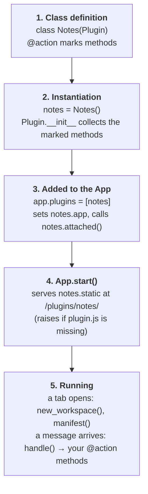
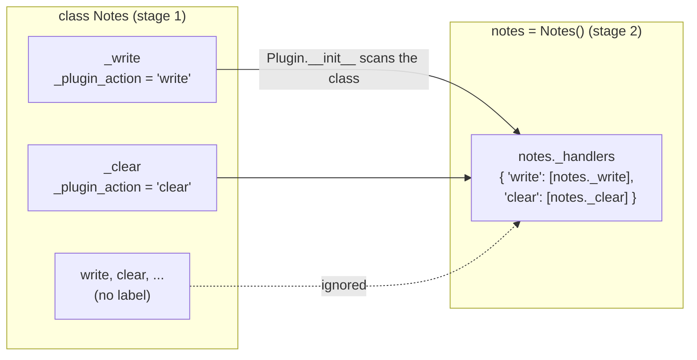
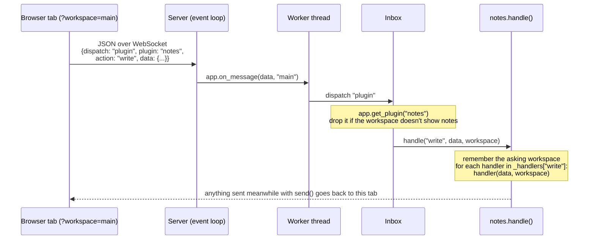
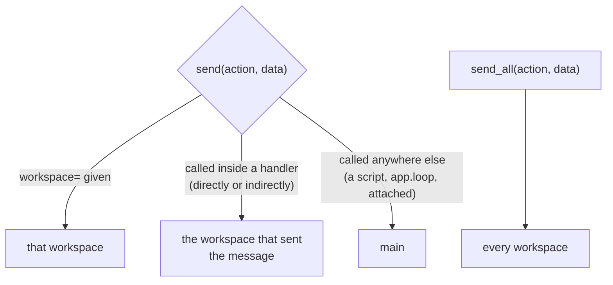

# The Python Half, Explained

[How Plugins Work](index.md) gives the overview. This page goes through the Python
half step by step: what each decorator does, when your code runs, and what happens to a
message between the browser and your method.

The examples use the `Notes` plugin from the [tutorial](tutorial.md).

## The life of a plugin object

A plugin object goes through five stages. Each one calls into your class at a fixed
point:



| Stage | What runs | What you can do there |
| --- | --- | --- |
| 1. Class definition | `@action("...")` | Mark methods as handlers |
| 2. `Notes()` | `Plugin.__init__` | Set up your own state, after `super().__init__()` |
| 3. `app.plugins = [...]` | `attached()` | Send state set before this point; `self.app` now exists |
| 4. `app.start()` | - | - |
| 5. Running | `new_workspace(workspace)`, `@action` methods, `on()` callbacks | Answer messages, send state |

Until stage 3, `self.app` is `None` and the plugin can't send anything: `send` and
`send_all` raise, while `hide`, `disable` & co. only remember the ids and send them in
`attached()`.

## `@action`: marking a method

```python
class Notes(Plugin):
    name = "notes"

    @action("write")
    def _write(self, data, workspace):
        ...
```

`@action("write")` does **one thing**: it puts a label on the function. It doesn't
register anything, doesn't wrap the function, and doesn't know about any `App`. This is
the whole decorator:

```python
def action(name):
    def decorate(method):
        method._plugin_action = name   # the label
        return method                  # the same function, unchanged
    return decorate
```

So the decorated method is still a normal method: you can call `notes._write(data,
workspace)` yourself, in a test for instance.

The label is read later, when the plugin object is created. `Plugin.__init__` looks at
every attribute of the class, and each method carrying a `_plugin_action` label is
added to a table of handlers, **bound to this object**:



In plain Python, `Plugin.__init__` does this:

```python
self._handlers = {}
for attribute in dir(type(self)):
    method = getattr(self, attribute, None)          # a bound method: self is filled in
    name = getattr(method, "_plugin_action", None)   # the label, if any
    if name:
        self._handlers.setdefault(name, []).append(method)
```

Consequences:

**Call `super().__init__()`.**
:   A subclass with its own `__init__` must call it first, or there is no handler
    table and the first message raises `AttributeError: ... no attribute '_handlers'`.

    ```python
    def __init__(self):
        super().__init__()   # collects the @action methods
        self._notes = {}
    ```

**The method name doesn't matter, the label does.**
:   `_write` handles `"write"` because of `@action("write")`. A leading underscore keeps
    handlers out of the plugin's public API, since users of the plugin call `write()`,
    not `_write()`.

**Several methods can handle one action.**
:   They all run, in **alphabetical order of their method names** (the order of
    `dir()`), not the order they are written in. If the order matters, use one handler
    that calls the others.

**Handlers are inherited.**
:   A subclass of `Notes` gets `_write` too. But if it *overrides* `_write`, the new
    method must carry `@action("write")` again: the label belongs to the function, and
    without it the action has no handler.

    ```python
    class LoudNotes(Notes):
        @action("write")                 # needed again
        def _write(self, data, workspace):
            print("writing", data)
            super()._write(data, workspace)
    ```

**Each object has its own table.**
:   Two `Notes()` objects are independent, each bound to its own state. (An `App` takes
    only one plugin per name, though.)

## `plugin.on`: adding a handler from outside

`@action` is for the plugin's author, inside the class. `on` is for the plugin's
*user*, in a script, to react to the same messages without subclassing:

```python
notes = Notes()

@notes.on("write")
def written(data, workspace):
    print("a note was written in", workspace.workspace_id)
```

`notes.on("write")` returns a decorator that appends `written` to the same handler
table, then returns `written` unchanged. You can also call it without the `@`:

```python
notes.on("write")(written)
```

| | `@action("write")` | `@notes.on("write")` |
| --- | --- | --- |
| Used by | the plugin's author | the plugin's user |
| Applies to | a method of the class | any function, on one plugin object |
| Registered | when the object is created | immediately |
| Runs | first (alphabetical among methods) | after the class's handlers, in the order added |
| Gets | `(self, data, workspace)` | `(data, workspace)` |

Because `on()` handlers run after the plugin's own, `written` above sees the note
already stored: `notes.notes` includes it.

## What happens to a message

Here is the full path of `channel.send("write", {guid, text})`, from the browser to
your method:



Step by step:

1. **The frontend sends** `{dispatch: "plugin", plugin: "notes", action: "write", data}`.
   The plugin name comes from `useChannel("notes")`.
2. **The server** gets it on the tab's WebSocket, which knows its workspace from the
   page URL (`?workspace=`, else `main`), and calls `App.on_message` on a **worker
   thread**, so a slow handler doesn't block the server.
3. **The inbox** looks up the plugin by name. Unknown plugin: logged, dropped. A plugin
   not in that workspace's `Workspace.plugins`: logged, dropped.
4. **`Plugin.handle`** records the asking workspace, then calls every handler of the
   action, in order, with `(data, workspace)`. No handler at all: a yellow log line
   *"Plugin 'notes' has no handler for 'write'"*.

`data` is whatever the frontend sent, decoded from JSON: dicts, lists, strings,
numbers, booleans, `None`. Geometry travels as guids; turn one back into the COMPAS
object with `self.app.find_geometry(guid)`.

!!! warning "An exception in a handler disconnects the tab"
    An uncaught exception in a handler ends that tab's WebSocket: the page stays up, but
    no longer talks to Python until it is reloaded. Validate what the browser sends,
    and catch what you can handle:

    ```python
    @action("write")
    def _write(self, data, workspace):
        geometry = self.app.find_geometry(data.get("guid", ""))
        if geometry is None:
            self.notify("That object is gone", "warning")
            return
        ...
    ```

!!! note "Threads"
    Messages from one tab are handled one after another. Messages from **different
    tabs** may be handled at the same time, on different threads, and so can a script's
    own code (`app.loop`, for instance). If a plugin's state can be changed from
    several tabs at once, guard it with a `threading.Lock`.

## Sending back: where does `send` go?

The answer depends on **where `send` is called from**. While `handle()` runs, the
plugin remembers which workspace asked (in a `ContextVar`, so each thread sees its
own); `send` uses it:



```python
@action("clear")
def _clear(self, data, workspace):
    self.clear()                      # calls send_all: every tab
    self.notify("Notes cleared")      # inside the handler: only the tab that asked
```

"Indirectly" matters: `_clear` calls `clear()`, which calls `_send_notes()`; any
`send` in there still answers the asking tab, because the call happens while the
handler runs.

| Method | Goes to | Kept for later tabs? |
| --- | --- | --- |
| `send(action, data)` | one workspace, as above | only with `key=` - replayed to tabs of that workspace |
| `send_all(action, data)` | every workspace | only with `key=` - replayed to every tab |
| `notify(message, kind)` | one workspace, as above; `workspace="all"` for every tab | never |
| `hide` / `show` / `disable` / `enable` | every workspace | always |

### `key`: state versus events

Without `key`, a message reaches the tabs connected right now, and is gone. With
`key="notes"`, the server also keeps it, replacing the previous message with the same
key, and sends it to each tab that connects later - a new tab, or a reload.

- **State** (the list of notes, saved views, which buttons are hidden): send the
  *whole* state, with a key. A new tab is then right from the start.
- **Events** ("move the camera there", "notes cleared"): no key. Replaying them to a
  tab that opens an hour later would be wrong.

On the frontend, the message reaches every `channel.on(action, handler)` of that
plugin, in each tab it was sent to:

```ts
viewer.channel("notes").on("notes", (data) => {
  notes.value = data as Note[];
});
```

## The other hooks

These are methods to **override**, not decorators. Call `super()` in `attached`.

`attached(self)`
:   Called by `app.plugins = [...]`, once `self.app` is set. Send the state built
    before that point here.

    ```python
    def attached(self):
        super().attached()      # sends hidden/disabled ids set before
        self._send_notes()
    ```

`new_workspace(self, workspace)`
:   Called when a tab asks for a workspace that doesn't exist yet, before the tab loads
    its plugins. Set `workspace.plugins` and fill the workspace here - for a tab your
    frontend opened with `window.open(viewer.workspaceUrl(id))`.

The `App` has two decorators of its own, for events that don't belong to one plugin:

```python
@app.on_object_transform
def moved(geometry, transformation, workspace):
    """The user moved an object with the gizmo; geometry is already transformed."""

@app.on_new_workspace
def opened(workspace):
    """Same as Plugin.new_workspace, for a script."""
```

## Class attributes, summarised

```python
class Notes(Plugin):
    name = "notes"                                # required; same as definePlugin({ name })
    static = Path(__file__).parent / "static"     # required; folder with plugin.js
    ids = ("edit", "clear", "note", "list")       # optional; catches typos in hide/disable
    in_main = True                                # optional; False: not in the main workspace
```

## Checklist

- [x] `name` is the same string in Python, in `definePlugin`, and in every `useChannel`.
- [x] `__init__` calls `super().__init__()` first.
- [x] Each `@action` name matches a `channel.send(name, ...)` in the frontend.
- [x] Handlers take `(data, workspace)` - or `(self, data, workspace)` as methods.
- [x] An overridden handler repeats its `@action`.
- [x] State goes out whole, with a `key`; events go out without one.
- [x] Handlers check their input instead of raising.
