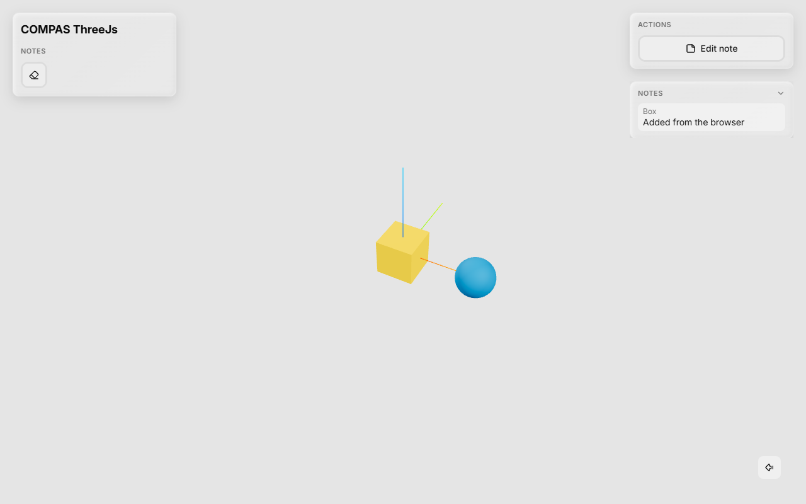
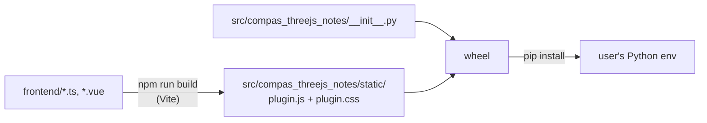

# Tutorial: Build a Plugin

This tutorial builds **Notes**, a plugin that lets the user attach a short note to any
object in the viewer. Along the way it uses every part of a plugin:

- a **toolbar button** with a keyboard shortcut (clear all notes),
- an **object action** in the picked object's panel (add or edit its note),
- a **panel** listing every note,
- a **Python half** that owns the notes, so every browser tab sees the same list, a
  reload keeps it, and a script can read and write notes.



Read [How Plugins Work](index.md) first if you haven't: it explains the pieces this
tutorial puts together.

!!! info "What you need"
    Python with `compas_threejs` installed, and [Node.js](https://nodejs.org) 22.12 or
    newer to build the frontend. People who *install* your plugin later need neither
    Node.js nor a build step: the wheel carries the built files.

## 1. The project layout

```text
compas_threejs_notes/
├── frontend/                  # the TypeScript half, built with Vite
│   ├── index.ts               #   definePlugin(...): the plugin's entry point
│   ├── notes.ts               #   state shared by the components
│   ├── ClearButton.vue        #   toolbar button
│   ├── NoteAction.vue         #   object action
│   ├── NotesPanel.vue         #   panel
│   ├── style.css, tailwind.css, theme.css, env.d.ts
├── src/compas_threejs_notes/  # the Python half
│   ├── __init__.py            #   class Notes(Plugin)
│   └── static/                #   built by `npm run build` - not committed
├── examples/notes.py
├── tests/test_notes.py
├── vendor/                    # the viewer package, see below
├── package.json, vite.config.ts, tsconfig.json
└── pyproject.toml
```

The build writes the frontend *into* the Python package (`src/compas_threejs_notes/static/`),
and `pyproject.toml` ships that folder in the wheel.



!!! tip
    The quickest start is to copy an existing plugin, such as `compas_threejs_views`,
    and rename it. The files below are complete, so you can also start from an empty
    folder.

## 2. The frontend toolchain

### `package.json`

```json
{
  "name": "compas-threejs-notes",
  "private": true,
  "type": "module",
  "scripts": {
    "build": "vite build",
    "watch": "vite build --watch",
    "typecheck": "vue-tsc --noEmit"
  },
  "devDependencies": {
    "@compas-dev/compas-threejs-ts": "file:vendor/compas-dev-compas-threejs-ts-1.5.0.tgz",
    "@tailwindcss/vite": "^4.3.3",
    "@vitejs/plugin-vue": "^6.0.8",
    "lucide-vue-next": "^0.563.0",
    "tailwindcss": "^4.3.3",
    "typescript": "~5.9.3",
    "vite": "^8.2.1",
    "vue": "^3.5.41",
    "vue-tsc": "^3.3.9"
  }
}
```

`@compas-dev/compas-threejs-ts` provides `definePlugin`, `useViewer`, the UI components
and their types.

!!! note "Getting the viewer package"
    Until a release of `@compas-dev/compas-threejs-ts` with the plugin API is on npm,
    plugins use a packed copy. In a checkout of `compas_threejs_ts` on the plugin branch,
    run `npm run build` and then `npm pack`, and copy the `.tgz` into your `vendor/`
    folder. Repack after the viewer's API changes.

### `vite.config.ts`

```ts
// Builds the plugin into the Python package, as src/compas_threejs_notes/static/plugin.js
// (+ plugin.css), which ships in the wheel. "vue", "three" and the viewer API stay
// imports: the viewer page provides them through its import map.
import path from "node:path";
import tailwindcss from "@tailwindcss/vite";
import vue from "@vitejs/plugin-vue";
import { defineConfig } from "vite";

export default defineConfig({
  plugins: [vue(), tailwindcss()],
  define: { "process.env.NODE_ENV": JSON.stringify("production") },
  build: {
    outDir: path.resolve(
      import.meta.dirname,
      "src/compas_threejs_notes/static",
    ),
    emptyOutDir: true,
    lib: {
      entry: path.resolve(import.meta.dirname, "frontend/index.ts"),
      formats: ["es"],
      fileName: () => "plugin.js",
      cssFileName: "plugin",
    },
    rollupOptions: {
      external: ["vue", "three", "@compas-dev/compas-threejs-ts"],
    },
  },
});
```

Three settings matter:

- `fileName: () => "plugin.js"` and `cssFileName: "plugin"` - the names Python serves.
- `formats: ["es"]` - the page loads the plugin with `import()`.
- `external` - **required**. A plugin that bundles its own Vue gets a second Vue, and
  `useViewer()` fails with *"must be called inside a viewer component"*.

### Styles and types

The viewer is styled with Tailwind; a plugin gets only the utility classes its own
components use, plus the viewer's colour tokens (`bg-secondary`,
`text-muted-foreground`, ...), which follow the light and dark theme.

```css title="frontend/style.css"
@import "./tailwind.css";
@source "./";
```

```css title="frontend/tailwind.css"
/* Only the utilities a plugin's own components use; the page already has the base styles. */
@import "tailwindcss/theme.css" layer(theme);
@import "tailwindcss/utilities.css" layer(utilities) source(none);
@import "./theme.css";
```

Copy `frontend/theme.css` (the viewer's theme tokens) from `compas_threejs_views` or
`compas_threejs_essentials`.

```ts title="frontend/env.d.ts"
declare module "*.vue" {
  import type { DefineComponent } from "vue";
  const component: DefineComponent;
  export default component;
}
```

```json title="tsconfig.json"
{
  "compilerOptions": {
    "target": "ES2022",
    "module": "ESNext",
    "moduleResolution": "bundler",
    "strict": true,
    "noEmit": true,
    "skipLibCheck": true,
    "lib": ["ES2022", "DOM", "DOM.Iterable"],
    "types": ["vite/client"]
  },
  "include": ["frontend/**/*.ts", "frontend/**/*.vue"]
}
```

Install the dependencies once:

```bash
npm install
```

## 3. The Python half

Start with Python: it decides what the plugin *is*. Python owns the notes; the browser
asks for changes and shows what Python sends back.

```python title="src/compas_threejs_notes/__init__.py"
from pathlib import Path

from compas_threejs.viewer import Plugin
from compas_threejs.viewer import action


class Notes(Plugin):
    """Notes on the viewer's objects, kept in Python.

    The user adds a note to the picked object from its panel; the Notes panel lists them
    all, in every browser tab. A script reads them in `notes` and writes them with `write`.

    Groups and buttons: ``edit`` (``clear``); object action ``note``; panel ``list``.
    E.g. ``notes.disable("clear")``.
    """

    name = "notes"
    static = Path(__file__).parent / "static"
    ids = ("edit", "clear", "note", "list")

    def __init__(self):
        super().__init__()
        self._notes = {}  # guid -> (geometry, text)

    @property
    def notes(self):
        """The notes, as ``(geometry, text)`` pairs."""
        return list(self._notes.values())

    @action("write")
    def _write(self, data, workspace):
        geometry = self.app.find_geometry(data["guid"])
        if geometry is not None:
            self.write(geometry, data["text"])

    @action("clear")
    def _clear(self, data, workspace):
        self.clear()
        self.notify("Notes cleared")

    def write(self, geometry, text):
        """Sets the note of `geometry`; an empty `text` deletes it."""
        text = text.strip()
        if text:
            self._notes[str(geometry.guid)] = (geometry, text)
        else:
            self._notes.pop(str(geometry.guid), None)
        self._send_notes()

    def clear(self):
        """Deletes every note."""
        self._notes.clear()
        self._send_notes()

    def attached(self):
        super().attached()
        self._send_notes()  # notes written before the plugin was added to the App

    def _send_notes(self):
        if not self.app:
            return
        notes = [{"guid": guid, "name": geometry.name, "text": text} for guid, (geometry, text) in self._notes.items()]
        # key: tabs opened later, and reloads, get the latest list too.
        self.send_all("notes", notes, key="notes")


__all__ = ["Notes"]
```

Line by line:

`name = "notes"`
:   The plugin's identity. The frontend uses the same string in `definePlugin` and
    `useChannel`, and the files are served under `/plugins/notes/`.

`static`
:   The folder holding the built `plugin.js`. `App.start()` raises if it's missing, with a
    hint to run `npm run build`.

`ids`
:   Every id the frontend declares. Optional, but with it `notes.hide("clean")` raises
    instead of silently doing nothing.

`@action("write")`
:   Handles the frontend's `channel.send("write", data)`. Handlers always get
    `(data, workspace)`: the JSON data, and the [`Workspace`](../reference/viewer/viewer.md)
    of the tab that sent it.

`self.app.find_geometry(guid)`
:   The frontend knows objects by guid; this turns one back into the COMPAS geometry.

`send_all("notes", ..., key="notes")`
:   Sends the whole list to every tab. The `key` makes the server keep the latest message
    and replay it to tabs that connect later. Use `send` instead to answer only the tab
    that asked.

`attached()`
:   Called when the plugin is added to an `App`. Before that there is no `self.app` to
    send through, so `write` before `app.plugins = [...]` just stores the note.

`self.notify(...)`
:   A short message at the bottom of the view, in the tab that asked.

For how `@action` and `notes.on` work under the hood, see
[The Python Half, Explained](python.md).

!!! warning "COMPAS geometry is not hashable"
    Keep geometry in lists or key dictionaries by `str(geometry.guid)`, as above -
    `{geometry: text}` raises `TypeError: unhashable type`.

### `pyproject.toml`

```toml
[build-system]
requires = ["setuptools>=66"]
build-backend = "setuptools.build_meta"

[project]
name = "compas_threejs_notes"
version = "0.1.0"
description = "Notes on the objects of the compas_threejs viewer, kept in Python"
requires-python = ">=3.10"
dependencies = ["compas_threejs"]

[tool.setuptools.packages.find]
where = ["src"]

# The built frontend (npm run build) ships inside the wheel.
[tool.setuptools.package-data]
"*" = ["static/*"]
```

## 4. The frontend

### Shared state: `notes.ts`

Three components show the notes. They read one reactive list, which `setup` fills with
what Python sends.

```ts title="frontend/notes.ts"
import { ref } from "vue";

export interface Note {
  guid: string;
  name: string;
  text: string;
}

/** The notes, as Python last sent them. Every component of the plugin reads this one list. */
export const notes = ref<Note[]>([]);
```

### The entry point: `index.ts`

`plugin.js` must default-export the result of `definePlugin`.

```ts title="frontend/index.ts"
import { definePlugin } from "@compas-dev/compas-threejs-ts";

import "./style.css";
import { notes, type Note } from "./notes";
import ClearButton from "./ClearButton.vue";
import NoteAction from "./NoteAction.vue";
import NotesPanel from "./NotesPanel.vue";

export default definePlugin({
  name: "notes",
  title: "Notes",
  // Ids are what Python hides or disables: notes.disable("clear")
  groups: {
    edit: { clear: ClearButton },
  },
  objectActions: {
    note: NoteAction,
  },
  panels: {
    list: { component: NotesPanel, title: "Notes" },
  },
  setup(viewer) {
    // Python owns the notes and sends the whole list whenever it changes.
    return viewer.channel("notes").on("notes", (data) => {
      notes.value = (data as Note[] | null) ?? [];
    });
  },
});
```

- `groups` maps group ids to buttons by id, in toolbar order. Each group is drawn as
  one shaded segment.
- `objectActions` appear in the *Actions* panel while an object is picked.
- `panels` with a `title` get a frame whose title bar folds them; `side` is `"right"`
  by default, or `"left"` under the toolbar.
- `setup` runs once, before the viewer mounts. `channel.on` returns an unsubscribe
  function, which doubles as `setup`'s cleanup.

Subscribing in `setup` rather than in the panel means the list is up to date even
while the panel is hidden or folded. [The Frontend Half, Explained](frontend.md)
explains why, along with the rest of what happens on this side.

### A toolbar button: `ClearButton.vue`

```vue title="frontend/ClearButton.vue"
<template>
  <ToolbarButton tooltip="Clear all notes" shortcut="N" @click="clear">
    <Eraser />
  </ToolbarButton>
</template>

<script setup lang="ts">
import {
  ToolbarButton,
  useChannel,
  useShortcuts,
} from "@compas-dev/compas-threejs-ts";
import { Eraser } from "lucide-vue-next";

const channel = useChannel("notes");
const clear = () => channel.send("clear");

useShortcuts({ n: clear });
</script>
```

`ToolbarButton` looks like the viewer's own buttons, shows the tooltip with the
shortcut, and greys itself out when Python disables it. `useShortcuts` binds lower-case
`event.key`s while the component is mounted; it stands down while the button is
disabled, while the user types in a field, and while another plugin holds input (a
drawing tool, for instance). `useChannel` is the component version of
`viewer.channel`: its `on` handlers are removed with the component.

### An object action: `NoteAction.vue`

```vue title="frontend/NoteAction.vue"
<template>
  <Button variant="secondary" class="w-full" @click="edit">
    <StickyNote class="size-4" />
    {{ current ? "Edit note" : "Add note" }}
  </Button>
</template>

<script setup lang="ts">
import { Button, useChannel, useViewer } from "@compas-dev/compas-threejs-ts";
import { StickyNote } from "lucide-vue-next";
import { computed } from "vue";

import { notes } from "./notes";

const viewer = useViewer();
const channel = useChannel("notes");

// The picked object's note, if it has one.
const current = computed(() => {
  const guid = viewer.state.selectedGuid.value;
  return notes.value.find((note) => note.guid === guid);
});

function edit() {
  const guid = viewer.state.selectedGuid.value;
  if (!guid) return;
  const text = window.prompt("Note", current.value?.text ?? "");
  if (text === null) return;
  // Python stores it and sends the new list back; an empty text deletes the note.
  channel.send("write", { guid, text });
}
</script>
```

The component doesn't update `notes` itself: it sends the request and waits for
Python's answer. That round trip is fast, and it means there is only one source of
truth.

### A panel: `NotesPanel.vue`

```vue title="frontend/NotesPanel.vue"
<template>
  <p v-if="!notes.length" class="text-muted-foreground text-sm">
    No notes yet: pick an object and add one.
  </p>
  <ul v-else class="flex flex-col gap-2 text-sm">
    <li
      v-for="note in notes"
      :key="note.guid"
      class="rounded-md px-2 py-1"
      :class="{ 'bg-secondary': note.guid === selected }"
    >
      <div class="text-muted-foreground text-xs">{{ note.name }}</div>
      {{ note.text }}
    </li>
  </ul>
</template>

<script setup lang="ts">
import { useViewer } from "@compas-dev/compas-threejs-ts";
import { computed } from "vue";

import { notes } from "./notes";

const viewer = useViewer();
const selected = computed(() => viewer.state.selectedGuid.value);
</script>
```

`viewer.state` is reactive, so the picked object's note is highlighted as the
selection changes.

## 5. Build and install

```bash
npm run build        # writes src/compas_threejs_notes/static/plugin.js + plugin.css
npm run typecheck    # optional: vue-tsc over the frontend
pip install -e .     # the Python half, editable
```

Add `src/compas_threejs_notes/static/` to `.gitignore`: it is a build output, rebuilt
before packaging the wheel.

## 6. Use it

```python title="examples/notes.py"
from compas.geometry import Box
from compas.geometry import Sphere

from compas_threejs.viewer import App
from compas_threejs_notes import Notes

app = App()
notes = Notes()
app.plugins = [notes]

box = Box(2, 2, 2)
box.name = "Box"
sphere = Sphere(1, point=[4, 0, 0])
sphere.name = "Sphere"
app.add_geometry(box)
app.add_geometry(sphere)

notes.write(box, "Check the dimensions")


@notes.on("write")
def written(data, workspace):
    print(f"{workspace.workspace_id}: {len(notes.notes)} notes")


app.start()
```

Run it: the *Notes* panel already shows the script's note. Pick an object and choose
*Add note* in its panel; press ++n++ to clear them all. Open the same URL in a second
tab: both show the same notes.

`notes.on("write")` adds a handler from outside the plugin; it runs after the
plugin's own. Combine plugins as usual - `app.plugins = [Essentials(), Views(), notes]` -
and control them from the script:

```python
notes.disable("clear")   # read-only: the button greys out, N does nothing
notes.hide("list")       # no panel
```

### The development loop

```bash
npm run watch        # rebuilds plugin.js on every save
```

Reload the browser tab to get the new build: the plugin's URL carries the file's
modification time, so the browser doesn't use a stale copy. Changes to the Python half
need the script restarted.

## 7. Test the Python half

Python can be tested without a browser: deliver messages as the frontend would, and
read what the plugin sends from the app's outbox.

```python title="tests/test_notes.py"
import json

import compas_pb
import pytest
from compas.geometry import Box

from compas_threejs.viewer import App
from compas_threejs_notes import Notes


def receive(app, action, data=None):
    """Delivers a message as the frontend's `channel.send(action, data)` would."""
    message = {"dispatch": "plugin", "plugin": "notes", "action": action, "data": data}
    app.on_message(json.dumps(message).encode("utf-8"))


def last_sent(app):
    return compas_pb.pb_load_bts(app.outbox._queue[-1][0])


def test_a_note_from_the_browser_is_stored_and_sent_back():
    app = App()
    notes = Notes()
    app.plugins = [notes]
    box = Box(1)
    app.add_geometry(box)

    receive(app, "write", {"guid": str(box.guid), "text": "Too small"})

    assert notes.notes == [(box, "Too small")]
    sent = last_sent(app)
    assert sent["action"] == "notes"
    assert sent["data"][0]["text"] == "Too small"


def test_an_empty_note_deletes_it():
    app = App()
    notes = Notes()
    app.plugins = [notes]
    box = Box(1)
    notes.write(box, "Too small")
    notes.write(box, "  ")
    assert notes.notes == []


def test_ids_are_checked():
    notes = Notes()
    notes.disable("clear")
    assert notes.disabled == {"clear"}
    with pytest.raises(ValueError):
        notes.hide("clean")
```

## 8. Troubleshooting

| Symptom | Cause |
| --- | --- |
| `FileNotFoundError: Plugin 'notes' has no built frontend` | Run `npm run build`; check `static` points at the build's `outDir`. |
| The section doesn't appear; the browser console says *Unable to load the "notes" plugin* | `plugin.js` failed to import - look at the error below it. Often a missing default export. |
| *useViewer() must be called inside a viewer component* | Vue was bundled into `plugin.js`; keep `vue`, `three` and the viewer package `external`. |
| The viewer doesn't mount at all | Two plugins with the same name, or a duplicate id within one plugin. |
| *Plugin 'notes' has no handler for 'write'* (Python log) | The action names on both sides differ. |
| `TypeError` in a handler with one argument | Handlers take `(data, workspace)`. |
| A plugin class looks wrong (no colours) | `theme.css` is missing, or a class is built from strings Tailwind can't see. |

## Where to go from here

- Interactive tools (a gizmo, drawing): `viewer.three` gives the camera, pointer rays,
  overlays and `beginInteraction`, which takes over pointer and keyboard input. The
  [frontend page](frontend.md#interactive-tools-begininteraction) adds a measuring tool
  to Notes; `compas_threejs_essentials` (gizmo) and `compas_threejs_draw` go further.
- A plugin that other plugins use: export an `api` from `definePlugin`; others call
  `viewer.plugin("notes")`.
- Tabs of their own: `viewer.workspaceUrl(id)` and `Plugin.new_workspace`.
- The full Python API: [Plugin reference](../reference/viewer/plugin.md).
