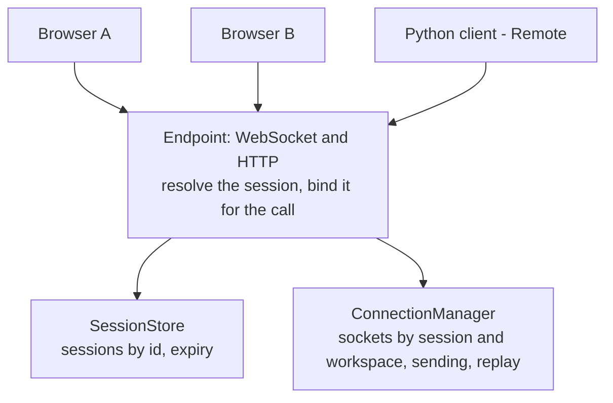

# Sessions: implementation plan

Status: phases 1 and 2 done (see Phases). Branch `feature/sessions`, from `feature/plugins`
(PR #63).

## Goal

Several clients use one running `App` at the same time, each with its own data, while
`app.py` and the plugins stay one shared instance. Handlers reach the current client's data
without passing a session id through every call.

```
App + plugins          one instance, the same code for everyone
  └── Session          one client: all of the App's features
        └── Workspace  one view of that client (main, beam_1, ...), one or more tabs
              └── Connection   one WebSocket; comes and goes
```

A session is not a workspace: a session has every feature, several workspaces included.
Two tabs of the same browser share a session; another browser or a private window gets
its own.

## The three levels



### 1. Clients

- **Browser:** no change in the TS frontend. The session travels in a cookie, which the
  browser sends with every HTTP request and with the WebSocket handshake. Cookies are not
  port-specific, so `?ws_host=`/`?ws_port=` still work. `?workspace=` stays as it is.
- **Python client (`Remote`):** gets a `session=` argument (the session's token), sent with
  the handshake. Without one it joins the default session, as today.

### 2. Endpoint

The session is resolved once, at the boundary, and bound to a `ContextVar` for everything
that follows.

- **WebSocket `/ws`:** the session from the cookie or the `Remote`'s token; the workspace
  from `?workspace=`. Both are bound before each message is handled. `asyncio.to_thread`
  copies the context, so handlers on the worker thread see them.
- **HTTP routes:** a middleware does the same, so plugin routes (for example Steko's
  `/steko/state`, `/steko/report`) answer for the asking session. `/plugins.json` is where
  a browser's session starts, as it is where a workspace starts today.
- **No valid cookie:** a new session, and a `Set-Cookie`. Session ids are random
  (`secrets.token_urlsafe`), the cookie is `HttpOnly` and `SameSite=Lax`.
- **Authorization:** an optional `App.authorize_session(callback)`; the callback gets the
  request and the session and may refuse it. Logging in is the host app's job (the Steko
  gateway, for example), not `compas_threejs`'s.

`_asking_workspace` in `plugin.py` is replaced by these two, set for every message, not
only plugin messages - so plain UI callbacks and `register_action` callables also know
their client.

### 3a. SessionStore

Decided: **Redis**, run in Docker (`docker-compose.yml` at the repository root).

A session holds live Python objects (geometry, a Steko `Configurator`), which can't be
stored in Redis. So the work is split in two (`stores.py`, `session.py`):

- **`SessionStore`: the records**, in Redis. A record is small: the session's id, when it
  started, when it was last seen. Redis expires it by itself. It says which sessions exist.
- **`SessionManager`: the live sessions**, in the server's memory, each with its `State`.
  A session whose record expired is ended at the next `sweep`. One whose record exists but
  isn't live here (the server restarted) starts again with an empty `State`.

```python
class SessionStore(Protocol):
    def create(self, session_id: str, timeout: float) -> dict: ...
    def get(self, session_id: str) -> dict | None: ...
    def touch(self, session_id: str, timeout: float) -> bool: ...
    def remove(self, session_id: str) -> None: ...
    def ids(self) -> Iterator[str]: ...
```

`RedisSessionStore` (`pip install compas_threejs[sessions]`) and `MemorySessionStore`, the
default, which needs nothing.

Later, a **snapshot** of a `State` a plugin writes and reads back (`Plugin.save_session` /
`restore_session`) can go in Redis too, so a session survives a restart with its data.
Several server processes also need each client sent to the same process every time
("sticky" routing), as the Steko gateway does now. Both are out of scope here.

### 3b. ConnectionManager

Taken out of `AppServer`, which today mixes it with the FastAPI app:

- the open sockets, by session and workspace;
- the saved state replayed to a tab that connects or reconnects (today
  `workspace_states` and `shared_state`);
- sending, batching (`pack_batch`), and the three reach levels below.

| Reach | Who gets it | Today |
|---|---|---|
| Workspace | the tabs of one workspace of one session | `workspace_id="..."` |
| Session | every workspace of one session | (none) |
| Everyone | every session, also replayed to new ones | `workspace_id=None` |

## Session and State

Two classes, so the handoff's `SessionContext` is split from the session itself:
**`Session`** is who the client is and how it is connected; **`State`** is everything that
client has. `State` is part of the `compas_threejs` core, not of the plugin system.

```python
class Session:
    id: str
    state: State
    created: float
    last_seen: float
    connections: int

    def run(self, function, *args): ...   # calls it bound to this session
    def bind(self, function): ...         # the same, for later: threads, timers


class State:
    """Everything one client has: one place, instead of spread over Inbox, Workspace,
    AppServer and each plugin as today."""
    workspaces: dict[str, Workspace]   # each has its own "main"; a workspace's settings
                                       # and what it shows (its scene)
    geometry: dict[str, Geometry]      # today Inbox.geometry_registry
    materials: dict[str, Material]     # today Inbox.material_registry
    metadata: dict[str, Metadata]      # today Inbox.metadata_registry
    actions: dict[str, Callable]       # today Inbox.buttons, object actions
    plugins: dict[str, Any]            # each plugin's part, see Plugins
```

Why `State` rather than `Scene`: a scene is what one workspace shows (geometry, lights,
camera); the state is all of a client's data: every workspace, the registries and the
plugins' data, of which the scenes are a part.

`State` is also what a later snapshot would save (see SessionStore); the WebSocket replay
log stays with the ConnectionManager, as it is a record of messages sent, not the data.

```python
current_session() -> Session      # raises NoSession outside of one
current_state() -> State          # current_session().state
current_workspace() -> Workspace
```

Outside of any session (startup, `attached()`, a plugin's own thread) these raise rather
than guess: a handler acting on the wrong client's data is worse than an error.

## Plugins

`app.py` and the plugins stay one instance. A plugin keeps on `self` only what is the same
for everyone (settings, callbacks, links to other plugins); what belongs to one client
goes in the session.

```python
class Steko(Plugin):
    def session_state(self):           # once for each new session
        return Configurator(...)

    @action("regenerate")
    def regenerate(self, data, workspace):
        self.state.regenerate()        # the current session's Configurator
```

- `Plugin.session_state()` - this plugin's state for a new session (default `None`).
- `Plugin.state` - that state, for the current session: its part of `State.plugins`.
- `Plugin.new_session(session)` / `Plugin.end_session(session)` - hooks, alongside the
  existing `new_workspace`.
- **One rule for reach:** a call made inside a session affects that session; a call made
  outside of one (at startup, in `attached()`) affects everyone. It applies to `send_all`,
  `notify(workspace="all")`, `hide`/`show`/`disable`/`enable`. A new `send_everyone` reaches
  every session from inside one, for data that is the same for all (Weather).
- **Threads:** a thread or timer a plugin starts doesn't inherit the session; it is started
  with `session.bind(function)`, or reaches only shared data.

### What each plugin keeps for one client

First pass, from what each class assigns on `self`; mutations through method calls
(`append`, ...) aren't counted.

| Plugin | Data for one client | Work |
|---|---|---|
| Wizard, Pixels, Costs, Fabrication, StekoLayers | none | none |
| Weather | none (the same for everyone; its thread uses `send_everyone`) | small |
| Essentials | `_locked` | small |
| Views | `views` | small |
| IO | `imported`, `_filename` | small |
| Layers | `_objects`, `_isolated`, `_last_sent`, `_base` | medium |
| Draw | `_claimed`, `_deleted`, `_editing`, `_edits`, `_history`, `_shape_edit`, ... | medium |
| Timber, ElementEditor, JointEditor | about 35: model, registries, open tabs | large |
| Steko | `configurator` (the whole building), `_element_tabs`; its HTTP routes are bound to the configurator | large |
| Base `Plugin` | `_hidden`, `_disabled` | by the reach rule |

## Lifecycle

- **Created** on the first request without a valid cookie (or for a `Remote` token the host
  app issued).
- **Kept** while it has connections. Reconnecting within the timeout gets the same session
  and its state is replayed.
- **Expired** `session_timeout` (default 30 minutes) after its last connection closed:
  `Plugin.end_session` runs, then its workspaces, registries and saved state are dropped.
  Today nothing is ever removed.

## Compatibility

Sessions are opt-in: `App(sessions=True)`. By default there is one default session that
every client joins, which is what happens today, so existing scripts, `Remote` and the
`App` shorthands (`app.add_geometry`, `app.main`, ...) keep working. Inside a session the
shorthands act on that session's `main`.

The safety check in that mode: `Plugin.state` and `current_session()` work there too, so a
plugin written for sessions also runs unchanged in a local script.

## Phases

Each is its own commit, with tests; the existing tests pass after each.

1. **Done.** `Session`, `State`, `SessionManager`, `MemorySessionStore`, `RedisSessionStore`,
   `current_session`/`current_state`/`current_workspace`, the default session. The `Inbox`
   registries moved into `State` (`Inbox` keeps them under their old names, as views), each
   `Workspace` registers into its own session's `State`, `App.on_message` binds the session
   and workspace for every message. No change in behaviour: every client is still in the
   default session. Tests: `tests/test_sessions.py`.
2. **Done.** `ConnectionManager` (`connections.py`) out of `AppServer`: sockets and persisted
   messages by session and workspace, the three reaches. The default session's messages are
   everyone's, so what `app.py` adds at startup reaches and is replayed to every session.
   Every send carries its session: a `Workspace` its own, other code the bound one, else the
   default. `Plugin.send_all` follows the reach rule; `Plugin.send_everyone` is new. Each
   `Session` counts its open tabs; an ended session's persisted messages are dropped.
   `AppServer.resolve_session` picks a connection's session (None: the default) - set in
   phase 3. Kept working for older code: `on_message(data, workspace_id)`, a replaced
   `Plugin._send`, outboxes without `session_id` (the default session isn't named).
   Tests: `tests/test_connections.py`, over real WebSockets.
3. **Endpoint:** cookie and `Remote` token, HTTP middleware, `authorize_session`,
   `App(sessions=True)`.
4. **Per-session core:** each session its own `State`; `App` shorthands act on it.
5. **Plugin API and lifecycle:** `session_state`/`state`, `new_session`/`end_session`, the reach
   rule, `send_everyone`, `bind`, expiry.
6. **Plugins, one at a time, in their own repositories:** the small ones, then Layers and Draw,
   then Timber, then Steko.

Tests to add: two sessions side by side see nothing of each other (scene, registries,
plugin state, HTTP routes); two tabs of one session share it; reconnecting keeps it; a
bound thread reaches the right session and an unbound one raises; expiry frees everything;
a forged or unknown cookie gets a new session.

## Out of scope

- Redis or a database for sessions, several server processes.
- Logging in and accounts: the host app's job.
- Changes to the TS frontend: none expected.
- Steko keeps one process per visitor until it has moved over (phase 6); whether it then
  serves several visitors from one process is a separate decision (one process shares one
  CPU core for Python work, and a crash affects everyone in it).

## Open questions

1. **What does a new session start with,** when `app.py` adds geometry at startup?
   Proposal: in `sessions=True` mode, startup content is replayed to every session as a
   shared starting scene, and editable content is added per session in
   `App.on_new_session(callback)`. Each session must get its own copies of anything it can
   change, or one client moving a beam moves it for everyone.
   **Decided for buttons and actions: every session gets them.** What is registered outside
   of any session (at startup, in `app.py`) is everyone's; what a session registers is its
   own, and comes first. They are kept once, in the default session's `State`; `Inbox.buttons`
   and `Inbox.action_registry` look in the session's, then in those (a `ChainMap`). A shared
   callback runs with the session that clicked bound. Done, with tests.
   For phase 2: the UI elements must also *show* in every session's tabs - what is sent
   outside of a session reaches everyone and is replayed to new sessions (the reach rule).
   **Decided for geometry: every session sees what `app.py` adds at startup** (done in
   phase 2: the default session's content is everyone's).
   Still open - **editing it**: a session moving a startup object with the gizmo, or changing
   its color. Proposal: that session gets its own copy at its first edit (same guid, so
   only its tabs swap it); the alternative is one shared world everyone edits. Today the
   shared object would be changed for everyone. Phase 4.
2. **`App` shorthands outside a session** with `sessions=True` (for example in `app.loop`):
   act on everyone, or raise? Proposal: everyone, by the reach rule.
3. **Session timeout default:** 30 minutes?
